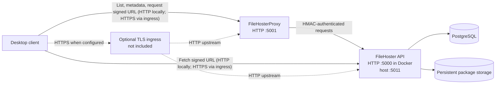

# FileHoster

FileHoster is a .NET 10 service for storing application packages and distributing them through short-lived signed download URLs. A separate proxy lets desktop clients list and download files without embedding the FileHoster secret.

Licensed under the [Apache License 2.0](LICENSE).

## Contents

- [Architecture and security](#architecture-and-security)
- [Prerequisites](#prerequisites)
- [Local development](#local-development)
- [Client API](#client-api)
- [FileHoster API](#filehoster-api)
- [Package upload](#package-upload)
- [Configuration](#configuration)
- [Build and test](#build-and-test)

## Architecture and security



With Docker Compose, the published endpoints use plain HTTP; HTTPS is not configured by this repository. For HTTPS deployments, configure an ingress to terminate TLS, set the proxy URL and `FILEHOSTER_PUBLIC_BASE_URL` to their HTTPS addresses, and keep direct backend ports protected. See [OPERATIONS.md](OPERATIONS.md).

> [!WARNING]
> The client-facing proxy does not authenticate callers. Anyone who can reach it can list packages and request signed download URLs for content the configured application may download. Signed URLs are bearer links until they expire. Restrict proxy access or add authentication at an ingress if the content should not be public.

Projects:

- `FileHoster/` - upload, query, metadata, signed-link, and download API.
- `FileHosterProxy/` - client-facing API that keeps HMAC credentials server-side.
- `FileHoster.Tests/` - unit tests for storage, permissions, authentication, and signatures.
- `SecureFileHosterClient.cs` - copyable Avalonia/.NET proxy client.
- `scripts/upload-packages.ps1` - uploads `.zip` and `.tar.gz` packages with matching JSON metadata.
- `scripts/upload-missing-packages.cmd` - Windows wrapper for verifying and uploading missing packages.

## Prerequisites

- .NET SDK 10.0.303 or a later 10.0 feature band (selected by `global.json`; all projects target .NET 10 LTS)
- Docker Desktop or Docker Engine with Compose
- PowerShell 7 for the upload scripts (`pwsh` on PATH)
- OpenSSH client for verified package uploads (`ssh` on PATH)

## Local development

Copy the example environment file and use development-only values:

```powershell
Copy-Item .env.example .env
docker compose -f docker-compose-local.yml up -d --build
docker compose -f docker-compose-local.yml ps
```

Wait until all three services report `healthy`, then check the services:

```powershell
Invoke-RestMethod http://localhost:5001/health
Invoke-RestMethod http://localhost:5001/api/v1/filehoster/health
Invoke-RestMethod http://localhost:5011/health
```

The client-facing file list is available at `http://localhost:5001/api/v1/filehoster/files`. On a fresh local database, before any uploads, it returns an empty list (`total: 0`, `items: []`).

These local endpoints use HTTP, not HTTPS:

| Service | Local URL |
|---|---|
| Proxy health | `http://localhost:5001/health` |
| Proxy file list | `http://localhost:5001/api/v1/filehoster/files` |
| FileHoster health | `http://localhost:5011/health` |

Stop the stack with:

```powershell
docker compose -f docker-compose-local.yml down
```

Run without Docker:

```powershell
dotnet run --project FileHoster\FileHoster.csproj --launch-profile http
dotnet run --project FileHosterProxy\FileHosterProxy.csproj
```

The FileHoster `http` launch profile listens on `http://localhost:5087`; its separate `https` profile is configured for `https://localhost:7173`. The proxy listens on port `5001`. Start PostgreSQL and configure `ConnectionStrings__PostgreSQL`, `InitialApplication__SecretKey`, `FileHoster__BaseUrl`, `FileHoster__PublicBaseUrl`, and `FileHoster__SecretKey` through environment variables. The application and proxy secret values must match; set the proxy base URL to the FileHoster address you are running.

## Client API

Desktop clients should call the proxy, not FileHoster directly.

| Method | Endpoint | Purpose |
|---|---|---|
| `GET` | `/health` | Proxy process health |
| `GET` | `/api/v1/filehoster/health` | Proxy plus upstream health |
| `GET` | `/api/v1/filehoster/files` | List available packages |
| `GET` | `/api/v1/filehoster/metadata/{fileId}` | Read package metadata |
| `GET` | `/api/v1/filehoster/download/{fileId}` | Create a signed download link |

Example:

```csharp
var client = new SecureFileHosterClient("http://localhost:5001");
var files = await client.GetFilesAsync();
var selected = files.OrderByDescending(file => file.CreatedAt).First();

await client.DownloadFileAsync(
    selected.FileId,
    selected.Filename,
    new Progress<double>(percent => Console.WriteLine($"{percent:0.0}%")));
```

The returned download URL is fetched directly from FileHoster and requires no additional client authentication. Download tokens use Base64URL signatures so route-safe tokens never contain `/`, `+`, or padding characters.

## FileHoster API

The proxy and trusted administrative tools use these endpoints:

| Method | Endpoint | Purpose |
|---|---|---|
| `POST` | `/api/{appId}/files/upload` | Upload one file and its JSON metadata |
| `POST` | `/api/{appId}/files/upload-bulk` | Upload multiple file/metadata pairs |
| `GET` | `/api/{appId}/files` | Query files |
| `GET` | `/api/{appId}/files/{fileId}` | Read file metadata |
| `POST` | `/api/{appId}/files/{fileId}/download-url` | Create a signed URL |
| `DELETE` | `/api/{appId}/files/{fileId}` | Delete a file |
| `GET` | `/download/{token}` | Download using a signed token |
| `GET` | `/health` | Service health |

Protected non-upload requests require:

```text
X-App-Id: <application ID>
X-Signature: <base64 HMAC-SHA256>
```

For every protected request, send `X-Timestamp` (Unix seconds), `X-Nonce` (fresh 32-character GUID in N format), `X-Content-SHA256` (lowercase hex digest), and `X-Signature` (base64 HMAC-SHA256). The signed UTF-8 value is:

```text
METHOD\nPATH_AND_QUERY\nAPPID\nTIMESTAMP\nNONCE\nCONTENT_SHA256\nMETADATA_SHA256
```

`PATH_AND_QUERY` includes the exact escaped query; for ordinary requests `CONTENT_SHA256` hashes the raw request body and `METADATA_SHA256` is empty. The server accepts timestamps within five minutes and stores nonces in PostgreSQL so the same request cannot be replayed.

For single multipart uploads, `CONTENT_SHA256` hashes the archive bytes, and `METADATA_SHA256` hashes UTF-8 `metadata + "\n" + originalFilename`. For bulk uploads, each header hashes the UTF-8 newline-joined list of per-file SHA-256 hex digests (metadata digests include each filename). The middleware authenticates the signed manifest without buffering entire archives; the controller verifies the metadata and stored bytes before publishing the record. Anonymous uploads are not supported. The upload script uses `FILEHOSTER_SECRET_KEY` from the operator environment (or `-SecretKey`).

`contentHash` is a `sha256:` digest of downloaded bytes for new packages; `metadataJsonHash` is the separate hash of the stored JSON. Older package records may have no content hash after migration and can only be checked by length unless re-uploaded.

## Package upload

Each archive must have a same-basename metadata file:

```text
win-x64.zip
win-x64.json
linux-x64.tar.gz
linux-x64.json
```

For a trusted package directory, run from Windows CMD in the repository root, replacing the example paths and hosts:

```cmd
scripts\upload-missing-packages.cmd -SourcePath "\\server\share\packages" -ApiUrl "http://server:5011" -ProxyUrl "http://server:5001" -Preview
scripts\upload-missing-packages.cmd -SourcePath "\\server\share\packages" -ApiUrl "http://server:5011" -ProxyUrl "http://server:5001" -SshTarget "user@server"
```

The wrapper checks both sidecar sizes and hashes, skips exact packages already hosted, retrieves the application key over SSH without displaying or storing it locally, uploads only missing packages, and verifies the resulting hashes through the proxy. `-Preview` performs read-only checks without SSH; `-SshTarget` is required only when an upload is needed. The SSH account must be able to read `~/filehoster/.env`, where `FILEHOSTER_SECRET_KEY` must be 64 lowercase hexadecimal characters for this wrapper. Existing HTTP endpoints must remain behind a firewall/VPN until TLS is configured.

For other package directories or deployments, use the generic uploader with a securely supplied `FILEHOSTER_SECRET_KEY`:

```powershell
.\scripts\upload-packages.ps1 `
  -SourcePath "C:\path\to\packages" `
  -ApiUrl "http://localhost:5011" `
  -AppId "SampleApp"
```

The generic uploader also accepts `-FileNames` to upload only selected archives. A failed partial upload can be retried with the wrapper; it rechecks the proxy before selecting files.

See `OPERATIONS.md` for production deployment, verification, backup, and troubleshooting.

## Configuration

Important environment variables:

| Variable | Used by | Purpose |
|---|---|---|
| `POSTGRES_PASSWORD` | Compose/PostgreSQL | Database password |
| `FILEHOSTER_SECRET_KEY` | FileHoster and proxy | Shared HMAC secret |
| `FILEHOSTER_PUBLIC_BASE_URL` | Proxy | Externally reachable FileHoster origin used in signed URLs |
| `ConnectionStrings__PostgreSQL` | FileHoster | PostgreSQL connection string |
| `StoragePath` | FileHoster | Persistent file directory |
| `FileHoster__BaseUrl` | Proxy | Internal FileHoster URL |
| `FileHoster__ApplicationId` | Proxy | Application/tenant ID |
| `FileHoster__SecretKey` | Proxy | HMAC secret |

Never commit real credentials. `.env` files are ignored; `.env.example` contains test-only placeholders.
Docker builds exclude environment-specific `appsettings.*.json` files other than `appsettings.Development.json`; provide production settings through the deployment environment.

Application permissions are stored per tenant:

- `CanUpload`
- `CanDownload`
- `CanQuery`
- `CanDelete`

Upload and delete should only be granted to trusted applications.

## Build and test

```powershell
dotnet build FileHoster\FileHoster.csproj
dotnet build FileHosterProxy\FileHosterProxy.csproj
dotnet test FileHoster.Tests\FileHoster.Tests.csproj
pwsh -NoProfile -File FileHoster.Tests\UploadMissingPackagesTests.ps1
```

Build the images from the repository root:

```powershell
docker build -f Dockerfile -t filehoster-filehoster:latest .
docker build -f FileHosterProxy\Dockerfile -t filehoster-proxy:latest .
```

## Repository policy

Do not commit:

- `bin/` or `obj/`
- Docker image archives
- uploaded package archives or staging folders
- credentials, private keys, or `.env` files
- logs, databases, backups, or runtime storage
- personal information or deployment-specific hostnames, addresses, usernames, and file paths

Git commits include author and committer names and email addresses. Configure a public-safe identity before committing, and review staged files and all history before publishing. Avoid `git push --mirror` unless every local reference is intended to be public.

Durable developer guidance belongs here. Production procedures belong in `OPERATIONS.md`.
